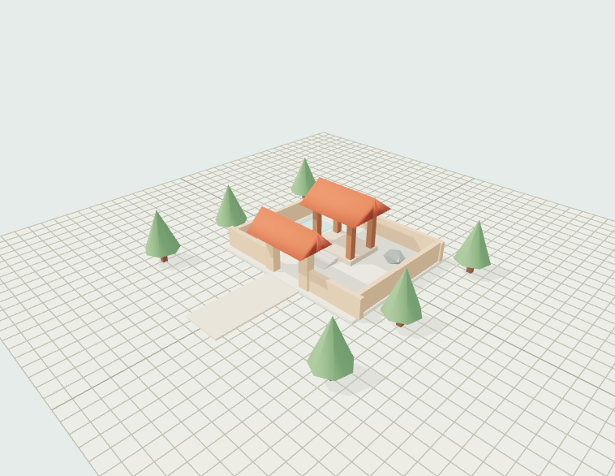

# Game-3DMaker

Xưởng dựng bản đồ 3D chạy trên localhost, giao diện tiếng Việt, nền sáng. Xây bằng khối và bộ phận lắp ghép, nhập GLB của bạn rồi đi thử ngay trong cảnh. Dự án độc lập, không sử dụng mã hay dữ liệu từ HueViVu.



## Chạy trên Windows

Yêu cầu Node.js 22 trở lên (đã thử với Node.js 24). Mở **Start-3DMaker.cmd** trong thư mục dự án. Lần đầu cần Internet để cài thư viện; những lần sau có thể dựng cảnh khi không có mạng. Giữ cửa sổ chạy app mở trong lúc sử dụng.

Trình chạy tự mở trình duyệt. Địa chỉ mặc định là **http://localhost:4317**. Nếu cổng bận, app dùng một cổng khác trong khoảng 4317–4346 và in địa chỉ thật trong cửa sổ chạy.

Hoặc chạy từ terminal trong thư mục dự án:

```sh
npm ci
npm run dev
```

Muốn dùng bản đã build:

```sh
npm run build
npm start
```

Máy chủ chỉ lắng nghe tại `127.0.0.1`. Không cần tài khoản, API key hay dịch vụ cloud. Ở chế độ phát triển, sau khi sửa mã giao diện hãy tải lại trang.

## Bắt đầu xây

1. Chọn **Mở cảnh mẫu** để đi thử khu vườn, hoặc **Tạo bản đồ** để có nền trống.
2. Chọn một bộ phận trong thư viện, rê chuột lên nền và bấm để đặt. Giữ và kéo để xây nhiều khối trong một lượt; nhấn Esc để hủy lượt xây đang dở.
3. Dùng **Chọn** rồi **Di chuyển**, **Xoay**, **Kích thước** để chỉnh bằng tay nắm. Có thể nhập số chính xác ở bảng Thuộc tính.
4. Dùng **Lặp thành hàng** để nhân nhiều bản theo khoảng cách. Chọn nhiều phần và **Lưu thành mẫu** để dùng lại cả công trình.
5. Bấm **Đi thử**, bấm vào cảnh rồi dùng W/A/S/D để đi. Trình duyệt không giữ được chuột sẽ dùng thao tác kéo để nhìn.
6. App tự lưu sau khoảng 1,6 giây ngừng chỉnh. Chờ dòng **Đã lưu trên máy** trước khi đóng cửa sổ chạy app.

## Công cụ hiện có

- Quản lý dự án: tạo, mở, đổi tên, tạo bản sao, ảnh xem trước sau khi chỉnh/lưu, chuyển vào thùng lưu.
- Khối vuông, tấm nền, tường, cột, dốc, bậc thang, mái, cổng, hàng rào, cây, đá và mặt nước.
- Đặt khối có bản mờ; kéo để xây/xóa liên tiếp; bám lưới 0,25/0,5/1/2 m hoặc đặt tự do; cố định độ cao xây.
- Chọn nhiều, chọn vùng bằng Shift + kéo, gom/tách nhóm, nhân bản, lặp thành hàng, căn hàng theo Z, đặt xuống nền, khóa và ẩn vật thể.
- Vật liệu đá, gạch, gỗ, cỏ, ngói, màu trơn; chỉnh màu, độ nhám, độ kim loại; bảng màu lưu cùng dự án.
- Gán ảnh texture riêng cho bộ phận: chọn PNG/JPEG/WebP từ máy, nút dán clipboard hoặc Ctrl+V; chỉnh lặp ngang/dọc và góc xoay, dùng lại ảnh đã nhập. Texture đi theo khi nhân bản, lưu mẫu và undo/redo.
- Góc phối cảnh, nhìn từ trên, bay, nhìn gần vật thể, đưa toàn cảnh vào khung hình; nhớ camera trong trình duyệt.
- Nhập GLB, đặt nhiều bản sao; thay màu gốc khi cần; tách các phần hình học có sẵn của GLB thành vật thể độc lập. Có thể gỡ tài nguyên không còn được cảnh/mẫu sử dụng.
- Lưu mẫu gồm nhiều bộ phận ngay trong dự án, giữ tài nguyên đi kèm khi xuất gói.
- Đi bộ, chạy, nhảy, va chạm đơn giản, lên bậc thấp, trở về điểm bắt đầu, đặt điểm bắt đầu ngay trong xưởng.
- Chỉnh kích thước nền, màu trời/đất, hướng nắng, bóng đổ và chất lượng; xem hộp va chạm.
- Hoàn tác/làm lại tối đa 80 bước trong phiên làm việc; tự lưu, lưu thủ công, 5 bản dự phòng; phát hiện xung đột khi hai cửa sổ cùng sửa dự án.
- Xuất gói `.3dmaker.zip` chứa cả bản đồ, GLB và ảnh; GLB toàn cảnh hoặc phần đang chọn; ảnh PNG không có bảng công cụ hay tay nắm. Vẫn nhập được gói JSON cũ.
- Hướng dẫn và phím tắt trong app. Màn hình hẹp có nút **Thuộc tính** để mở bảng chỉnh.

## Phím tắt

| Phím                    | Thao tác                                    |
| ----------------------- | ------------------------------------------- |
| V / B                   | Chọn / xây                                  |
| G / R / T               | Di chuyển / xoay / kích thước               |
| X / I / P               | Xóa / lấy mẫu vật thể / đặt điểm bắt đầu    |
| [ / ]                   | Xoay bộ phận trước khi đặt                  |
| F                       | Nhìn gần phần đang chọn                     |
| Ctrl + bấm              | Thêm/bỏ vật thể trong lựa chọn              |
| Shift + kéo             | Chọn vùng, thuận tiện nhất khi nhìn từ trên |
| Alt + bấm               | Chọn riêng một phần của nhóm                |
| Ctrl D / Ctrl G         | Nhân bản / gom nhóm                         |
| Ctrl A                  | Chọn tất cả vật thể đang hiện và không khóa |
| Ctrl Z / Ctrl Shift Z   | Hoàn tác / làm lại                          |
| Ctrl S                  | Lưu                                         |
| Delete                  | Xóa vật thể đang chọn                       |
| W A S D / Q E           | Bay khi ở góc Bay                           |
| W A S D / Shift / Space | Đi / chạy / nhảy khi đi thử                 |
| Esc                     | Hủy thao tác đang dở / về xưởng             |

## Dữ liệu và sao lưu

```text
data/
  <project-id>.json     Mô tả bản đồ, tham chiếu tới file GLB/ảnh
  assets/               File GLB/texture riêng và thông tin đi kèm
  backups/              Tối đa 5 phiên bản trước cho mỗi dự án
  trash/                Dự án đã cất, có thể lấy lại thủ công
```

Thư mục `data/` được Git bỏ qua. Push/pull mã nguồn không đưa bản đồ của bạn lên GitHub. Để chuyển bản đồ sang máy khác, dùng **Xuất → Gói dự án**, rồi nhập gói đó trên máy đích. Có thể sao lưu cả thư mục `data/` khi app đã dừng.

GLB mới được tải thẳng xuống file trên đĩa, không chuyển thành chuỗi base64 và không ghi lại vào mỗi bản lưu. Khi sao lưu thủ công cần giữ **toàn bộ data/**, đặc biệt `data/assets/`. Bản đồ cũ có GLB nhúng vẫn mở được. Gói ZIP xuất mới đóng gói cả tài nguyên cũ và mới.

**Bản mô tả .3dmaker.json** là cách giữ thay đổi khi máy chủ local gặp sự cố, có thể xuất ngay cả khi máy chủ đã dừng. Với tài nguyên file riêng, JSON này chỉ dùng lại được khi còn các file trong `data/assets/`; để chuyển máy hãy dùng ZIP.

## Dán ảnh lên tường hoặc bộ phận

Chọn vật thể trong cảnh hoặc danh sách, kéo bảng Thuộc tính tới **Ảnh texture**, rồi chọn ảnh từ máy hoặc bấm **Dán ảnh clipboard**. Cũng có thể nhấn Ctrl+V khi đang chọn vật thể và không nhập chữ trong ô tên/số.

Đặt **Lặp ngang**, **Lặp dọc** để đổi mật độ gạch và **Xoay ảnh** để đổi hướng. Chọn **Dùng ảnh đã nhập** để áp dụng cùng một ảnh cho bộ phận khác. **Gỡ texture khỏi bộ phận** không xóa file ảnh khỏi dữ liệu dự án. Chọn vật liệu dựng sẵn sẽ gỡ texture riêng để dùng vật liệu đó.

Ảnh tối đa 32 MB; cạnh dài được thu về tối đa 4096 px để giảm tải GPU. Mặc định giữ PNG; ảnh quá lớn sau xử lý được tối ưu sang WebP. Trên GLB, ảnh theo UV gốc; nếu thiếu UV, app tạo phép chiếu phẳng cơ bản, có thể bị kéo giãn trên các mặt khác hướng.

Khôi phục bản dự phòng ngay trong app. Với dự án hỏng, mở **Dự án → Bản dự phòng** để khôi phục thành dự án mới. Muốn lấy lại dự án trong thùng lưu, khi app đã dừng, chép file từ `data/trash/<id>_<thời điểm>.json` về `data/<id>.json`, giữ nguyên phần `<id>` và tránh ghi đè một dự án đang tồn tại.

Nếu lưu thất bại, app giữ thay đổi trong phiên hiện tại và cho **Xuất để giữ thay đổi**. Nếu có xung đột hai cửa sổ, xuất bản đang sửa trước, mở lại bản mới nhất, rồi nhập gói nếu muốn giữ cả hai phương án.

## Giới hạn của bản này

- Ưu tiên chuột và bàn phím trên máy tính. Giao diện thu gọn được trên màn hình hẹp, chưa có bộ điều khiển xây/đi bộ bằng cảm ứng.
- Mỗi GLB **nhỏ hơn 1 GB (1.000.000.000 byte)**; ảnh texture tối đa 32 MB; mô tả bản đồ tối đa 64 MB, ZIP tối đa 4 GiB và tổng tài nguyên cần nhỏ hơn giới hạn gói. Tối đa 5.000 vật thể, 100 tài nguyên và 50 mẫu. Đây là giới hạn dữ liệu, không phải cam kết tốc độ ở mức tối đa. Đã thử GLB khoảng 40 MB, chưa benchmark mô hình gần 1 GB; file lớn cần đủ RAM/GPU.
- GLB cần nhúng dữ liệu và ảnh bên trong. Chưa hỗ trợ Draco, Meshopt, KTX2 hoặc phát animation. Mô hình có bộ xương vẫn có thể đặt dạng tĩnh, nhưng không tách thành bộ phận.
- Tách GLB dựa trên phần hình học thực sự có trong file (tối đa 300 phần); không tự nhận diện mái/cửa/cột của một khối liền. Không có chỉnh từng đỉnh hoặc điêu khắc.
- Va chạm dùng hộp bao từng phần; dốc dùng các bậc nhỏ xấp xỉ. Vật thể xoay, tán cây hoặc mô hình cong có thể chặn rộng hơn hình nhìn thấy. Có thể tắt va chạm trên các vật thể trang trí.
- Mặt nước chỉ trang trí. Không có thế giới vô hạn, multiplayer, sinh tồn hoặc AI tạo mô hình.
- Undo chỉ giữ trong phiên hiện tại. Các bản dự phòng trên máy là cách quay lại sau khi đóng app.
- Mẫu được đặt tại tâm bản đồ trước; dùng tay nắm Di chuyển để đưa tới chỗ mong muốn.

## Cập nhật mã nguồn

Mở **Sync-Project.cmd** để kéo bản mới bằng fast-forward và cài đúng phiên bản thư viện. Script dừng nếu mã đã theo dõi có thay đổi, không dùng reset hay force pull. Khi đang chạy app, dừng rồi mở lại sau khi cập nhật.

Script này chỉ đồng bộ mã nguồn. Bản đồ vẫn lưu riêng trong `data/`.

## Kiểm tra cho người phát triển

```sh
npm test
npm run typecheck
npm run build
```

`npm test` kiểm tra dữ liệu dự án, undo/redo, nhân bản nhóm, GLB, hình học cổng/bậc thang, bảo toàn vị trí khi tách mô hình, lưu nguyên tử, xung đột, xoay vòng bản dự phòng và API local. GitHub Actions chạy test và build khi có push/PR.

`npx tsx scripts/create-test-assets.ts` tạo các file kiểm thử trong `test-results/` để thử nhập GLB hợp lệ, GLB lỗi và gói dự án lỗi qua giao diện. Kết quả kiểm tra thực tế được ghi ở [docs/VERIFICATION.md](docs/VERIFICATION.md).

`npx tsx scripts/create-texture-test-assets.ts` tạo ảnh gạch và GLB khoảng 40 MB để thử tính năng texture/file lớn. Test API bao gồm upload có giới hạn, tải theo Range, ZIP chứa tài nguyên, chống đường dẫn lạ và từ chối gói thiếu file.
